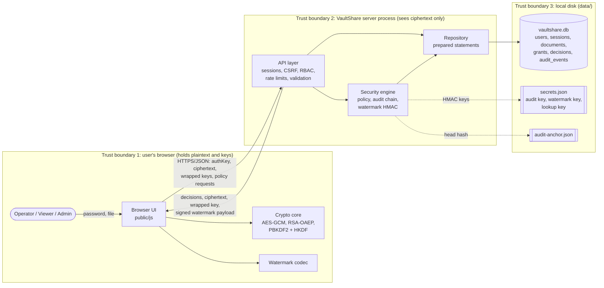
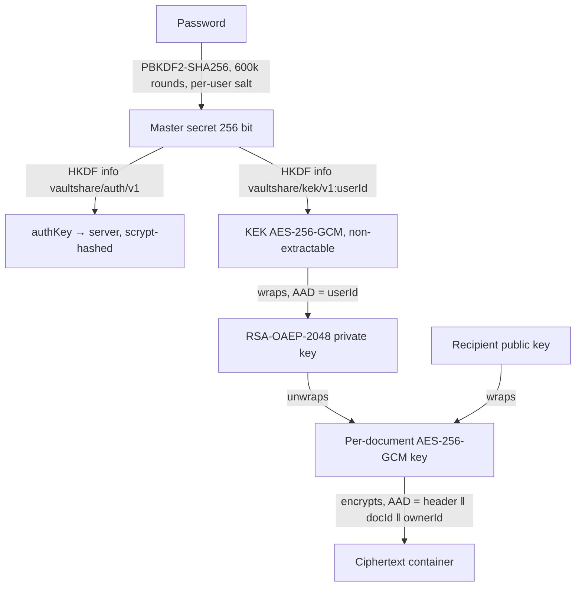

# Architecture and data flow

## Layers

VaultShare follows the five-layer design required by the specification. Security logic lives in the engine and the shared crypto core, never only in presentation code.

| # | Layer | Location | Responsibility |
|---|---|---|---|
| 1 | Browser interface | `public/` | Validated input, client-side encryption and watermarking, explainable output (verdict slips) |
| 2 | API / service layer | `server/api/` | Sessions, CSRF, origin checks, role permissions, rate limits, request validation, stable error codes |
| 3 | Security engine | `server/engine/`, `shared/` | Policy rules, permission matrix, audit hash chain, watermark signing, validation, redaction; AES-GCM / RSA-OAEP / PBKDF2 / HKDF crypto core |
| 4 | Repository | `server/repo/` | SQLite schema, all SQL as prepared statements, append-only audit table with triggers |
| 5 | Test fixtures | `fixtures/`, `scripts/lib/harness.js` | Safe samples, adverse inputs, isolated test instances with an injectable clock |

The crypto core (`shared/crypto-core.js`) and watermark codec (`shared/watermark-codec.js`) are isomorphic ES modules: the browser, the seed script, the tests and the evaluation harness run the identical code.

## Data-flow diagram with trust boundaries


The same diagram as editable Mermaid source:



**What crosses each boundary**

| Flow | Crosses | Content | Protection |
|---|---|---|---|
| Password | never leaves TB1 | — | Only `authKey = HKDF(PBKDF2(password))` is sent |
| Sign-in | TB1 → TB2 | username, authKey | scrypt-hashed at rest; generic errors; rate limited; decoy salts for unknown users |
| Upload | TB1 → TB2 | ciphertext container, DEK wrapped to owner's public key | GCM tag; structural + length validation; type/size policy |
| Share | TB1 → TB2 | DEK wrapped to recipient public key, recipient fingerprint | fingerprint must match recipient's current key; TTL and limit policy |
| Open | TB2 → TB1 | ciphertext, wrapped DEK, signed watermark payload | released only after an `allow` decision; atomic download counting |
| Persistence | TB2 → TB3 | records, ciphertext blobs | parameterised SQL; `secure_delete`; append-only triggers; HMAC chain with key outside the DB |

## Key hierarchy




### Ciphertext container (`VSH1`)

| Offset | Bytes | Field |
|---|---|---|
| 0 | 4 | magic `56 53 48 31` ("VSH1") |
| 4 | 1 | version = 1 |
| 5 | 1 | IV length = 12 |
| 6 | 12 | random IV |
| 18 | n | AES-GCM ciphertext |
| 18+n | 16 | GCM tag |

AAD = the 18 header bytes ‖ `vaultshare/doc/v1:<docId>:<ownerId>`. Changing any header byte, moving ciphertext to another document, or altering a single bit fails authentication. Total length is always plaintext + 34 bytes, which the server checks without any key.

## Working sequence (spec page 2)

1. **Account and roles (FR-1)** — the session is loaded, CSRF and origin checked, role permission tested. Invalid input is rejected by the strict validator before any processing.
2. **AES-GCM encryption (FR-2)** — the browser measures the file's first 8 bytes and UTF-8 validity (no contents) and sends them with the upload request. The **server** decides: extension and MIME allow-list, size, and whether the first bytes match the name (`evaluateUploadMeta`, rule `CONTENT_TYPE_MISMATCH`). Only then does the browser encrypt; the server validates the container structure and exact length (`evaluateUploadContent`). If the browser later finds tampered ciphertext it reports it (`/integrity-failure`), so that is recorded server-side too.
3. **Key wrapping (FR-3)** — the DEK is wrapped for the owner at upload and re-wrapped for each recipient at share time. The server checks wrapped-key length and the recipient fingerprint (`evaluateGrant`).
4. **Expiry / revocation (FR-4)** — every open goes through `evaluateDownload` (revoked → expired → limit → key version), then an atomic conditional update consumes one download.
5. **Watermarking (FR-5)** — the server issues an HMAC-signed payload bound to the download; the browser embeds it (visible + invisible).
6. **Audit trail (FR-6)** — each step appends a redacted event to the HMAC chain; the decision record (rule, reason, evidence, engine version, settings version, latency) is stored and shown in the verdict slip, decision history and exports.

## Data model

| Table | Key columns | Notes |
|---|---|---|
| `users` | id (UUID), username, role, status (`pending`/`active`/`disabled`), kdf_salt, kdf_iterations, auth_hash, auth_salt, public_key, key_fingerprint, wrapped_private_key, wrap_iv, key_version, enroll_code_hash, enroll_expires_at | private key stored only wrapped; enrollment code stored as SHA-256 |
| `sessions` | id_hash (SHA-256 of cookie token), user_id, csrf_token, last_seen_at, expires_at | idle and absolute expiry |
| `settings_versions` | version, settings (JSON), diff, reason, changed_by | every change is a new row |
| `documents` | id, owner_id, filename, extension, mime_type, size_plain, size_cipher, cipher_sha256, binding, status, content (BLOB), config_version | content is ciphertext; nulled on delete |
| `grants` | id, document_id, recipient_id, is_owner, wrapped_key, recipient_key_fingerprint, recipient_key_version, expires_at, max_downloads, download_count, revoked_at, revoked_by | wrapped key nulled on revoke |
| `downloads` | id, grant_id, document_id, user_id, decision_id, created_at | one row per released copy; the watermark payload references it |
| `decisions` | id, ts, actor, action, subject, decision, rule, reason, severity, recommended_action, evidence (JSON), engine, config_version, latency_ms | explainable result store |
| `audit_events` | seq, ts, actor_id/name/role, action, target, outcome, request_id, ip_hash, details (JSON), prev_hash, hash | triggers block UPDATE and DELETE |

Identifiers are generated server-side (`crypto.randomUUID`). IP addresses are stored only as a keyed hash.

## Schemas

### Decision / result

```json
{
  "id": "36ad1279-…",
  "decision": "allow | deny",
  "rule": "GRANT_EXPIRED",
  "reason": "The grant passed its expiry time.",
  "severity": "info | low | medium | high",
  "recommendedAction": "Ask the file owner to share it again.",
  "evidence": { "grantId": "…", "expiresAt": "…", "evaluatedAt": "…", "downloadsUsed": 1, "downloadLimit": 3 },
  "engine": "vaultshare-policy/1.1.0",
  "configVersion": 2,
  "latencyMs": 0.33
}
```

Severity and recommended action come from `RULE_META` (every rule has both; a unit test enforces it). The full rule catalogue is `RULES` in `server/engine/policy.js` and is listed in the administrator overview.

### Audit event

```json
{
  "seq": 34, "ts": "2026-10-19T19:18:19.247Z",
  "actor_id": "…", "actor_name": "victor", "actor_role": "viewer",
  "action": "DOWNLOAD_ALLOW", "target_type": "document", "target_id": "…",
  "outcome": "success | denied | error | info",
  "request_id": "…", "ip_hash": "16 hex",
  "details": { "grantId": "…", "downloadId": "…", "rule": "ALLOW_GRANT", "decisionId": "…" },
  "prev_hash": "64 hex", "hash": "HMAC-SHA256(auditKey, prev_hash | canonical_json(event))"
}
```

### Input schemas

Every request body is checked by `server/engine/validation.js`: unknown fields are rejected, strings are NFC-normalised and refused if they contain control or bidi-override characters, base64 must decode to an exact or bounded length, integers must be in range, and usernames match `^[a-z][a-z0-9._-]{2,31}$`. See [api.md](api.md) for every endpoint's fields.
